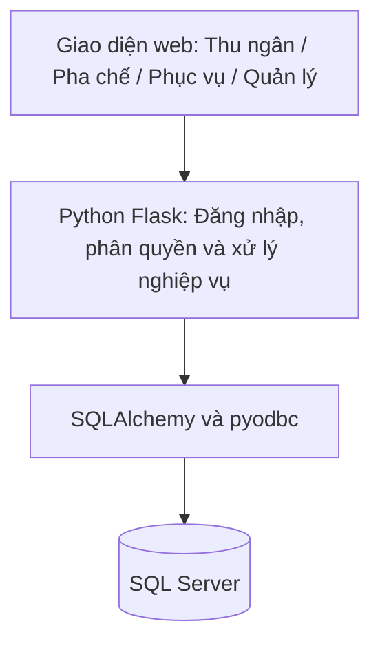

# KIẾN TRÚC HỆ THỐNG LAPH CAFE

## 1. Công nghệ sử dụng

Nhóm dự kiến xây dựng LAPH CAFE dưới dạng ứng dụng web, gồm bốn nhóm người dùng: thu ngân, pha chế, phục vụ và quản lý. Các chức năng được tổ chức trên cùng một hệ thống để thông tin đơn hàng được cập nhật xuyên suốt quá trình bán hàng.

| Thành phần | Công nghệ | Vai trò |
|---|---|---|
| Giao diện | HTML, CSS, JavaScript, Bootstrap | Hiển thị và tương tác với người dùng |
| Máy chủ ứng dụng | Python Flask | Xử lý yêu cầu, phân quyền, nghiệp vụ đơn hàng |
| Truy cập dữ liệu | SQLAlchemy, pyodbc | Kết nối và thao tác với cơ sở dữ liệu |
| Cơ sở dữ liệu | Microsoft SQL Server | Lưu đơn hàng, sản phẩm, nhân viên và các thông tin liên quan |
| Kiểm thử | pytest | Kiểm tra các chức năng xử lý nghiệp vụ |

## 2. Sơ đồ kiến trúc

Hệ thống được chia thành ba lớp: giao diện người dùng, xử lý nghiệp vụ và dữ liệu. Thu ngân tạo đơn, bộ phận pha chế tiếp nhận thông tin món, còn phục vụ theo dõi và cập nhật việc giao nước. Mỗi vai trò có các chức năng phù hợp với công việc của mình.

**Lớp giao diện:** Hiển thị thực đơn, hóa đơn, danh sách chờ pha chế và các đơn cần giao.

**Lớp xử lý nghiệp vụ:** Kiểm tra dữ liệu nhập, tính tiền, lưu ghi chú món, xử lý trạng thái đơn và kiểm soát quyền thao tác.

**Lớp dữ liệu:** Lưu thông tin sản phẩm, nhân viên, hóa đơn, chi tiết hóa đơn, thanh toán và lịch sử cập nhật.

## 3. Thiết kế dữ liệu ban đầu

| Bảng | Nội dung lưu trữ |
|---|---|
| `roles` | Các vai trò trong hệ thống |
| `employees` | Tài khoản và thông tin nhân viên |
| `categories` | Danh mục sản phẩm |
| `products` | Tên món, đơn giá và trạng thái kinh doanh |
| `table_cards` | Danh sách thẻ số của quán |
| `card_sessions` | Lượt sử dụng thẻ và vị trí khách nếu có |
| `orders` | Thông tin chung của hóa đơn |
| `order_items` | Món, số lượng, đơn giá bán, ghi chú và trạng thái pha chế |
| `payments` | Phương thức và số tiền thanh toán |
| `order_status_history` | Lịch sử thay đổi trạng thái đơn hàng |

Một hóa đơn có nhiều món; một món có thể xuất hiện trong nhiều hóa đơn. Thông tin món và số lượng được lưu tại bảng `order_items`.

Số thẻ do khách cầm **không phải số bàn cố định**. Vì khách có thể chọn chỗ ngồi hoặc đổi vị trí, hệ thống sử dụng thông tin vị trí riêng và cho phép nhân viên phục vụ cập nhật khi biết vị trí mới.

## 4. Các yêu cầu cần lưu ý

- Ghi chú phải gắn với từng món trong đơn và được hiển thị đầy đủ ở màn hình pha chế.
- Đơn giá của món được lưu theo thời điểm bán để tránh ảnh hưởng đến hóa đơn cũ khi giá thay đổi.
- Mỗi thẻ số chỉ được cấp cho một lượt khách đang sử dụng tại cùng thời điểm.
- Chức năng đăng nhập và phân quyền cần giới hạn các thao tác theo từng bộ phận.
- Hệ thống lưu người thực hiện và thời điểm cập nhật đối với các thao tác quan trọng.
- Mật khẩu được lưu dưới dạng mã hóa một chiều; thông tin kết nối cơ sở dữ liệu được quản lý riêng.
- Giao diện cần dễ đọc và sử dụng được trên các kích thước màn hình khác nhau.

Đây là phương án kiến trúc ban đầu. Sơ đồ cơ sở dữ liệu và cách tổ chức các chức năng sẽ được nhóm điều chỉnh sau khi đối chiếu với phần phân tích nghiệp vụ và giao diện.
