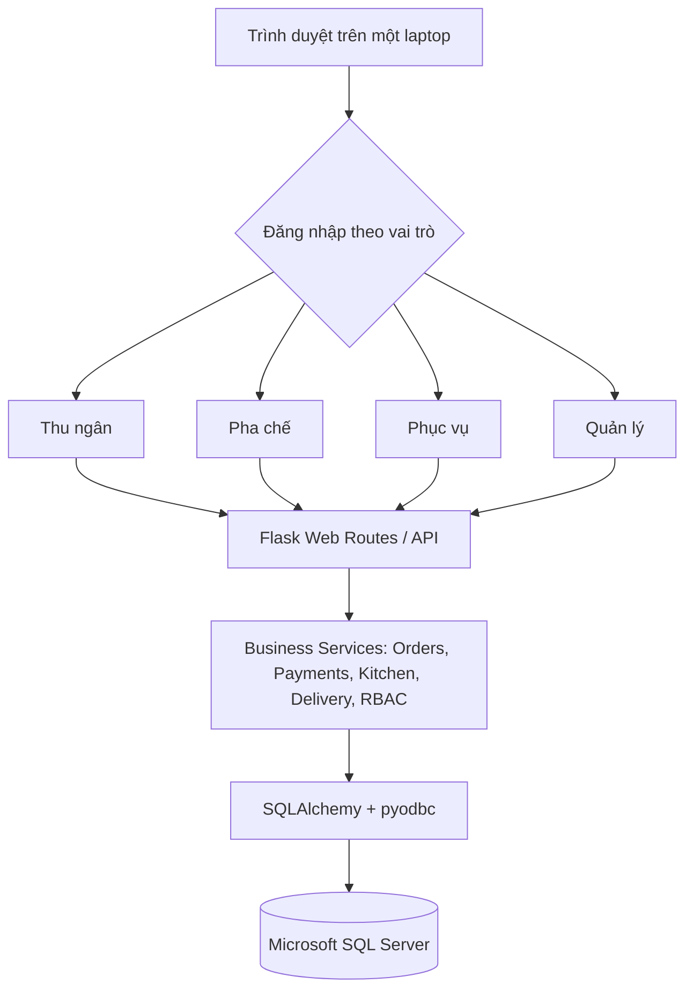

# Kiến trúc kỹ thuật dự kiến — Demo trên một máy

**Lựa chọn:** Web responsive, Flask + HTML/CSS/JS + Bootstrap + Microsoft SQL Server, phù hợp triển khai demo một máy tại lớp.

## Sơ đồ 3 lớp



## Cấu trúc mã nguồn dự kiến (chưa cần lập trình ở Sprint 0)

```text
laph-cafe/
  app/
    __init__.py
    routes/       # order, kitchen, delivery, admin, auth
    services/     # nghiệp vụ, kiểm tra trạng thái
    models/       # SQLAlchemy ORM
    templates/    # Jinja2, Bootstrap responsive
    static/       # CSS, JavaScript, assets
  tests/
  docs/
  requirements.txt
  config.example.env
  run.py
```

## Dữ liệu chính và liên kết

- `roles` 1–N `employees`: phân quyền theo vai trò.
- `categories` 1–N `products`: thực đơn.
- `orders` 1–N `order_items`: ghi chú, số lượng, đơn giá tại thời điểm bán, trạng thái từng món.
- `orders` 1–N `payments`: hỗ trợ lưu nhiều giao dịch trong tương lai; MVP có thể một thanh toán.
- `table_cards` 1–N `card_sessions`: **số thẻ không phải số bàn**; mỗi lần cấp thẻ tạo một lượt sử dụng.
- `card_sessions` 1–N `orders`: cho phép một lượt thẻ gắn các đơn liên quan nếu cần.
- `location_history` N–1 `card_sessions`: cập nhật vị trí khi nhân viên xác nhận, không theo dõi khách tự động.
- `order_status_history` N–1 `orders`: người thao tác, thời gian, trước/sau.

## Ràng buộc dữ liệu quan trọng

1. `order_items.note` lưu ghi chú *từng món*, truyền nguyên vẹn sang giao diện pha chế.
2. `order_items.unit_price_at_sale` là giá bán lịch sử, không bị thay đổi khi cập nhật menu.
3. `table_cards.card_number` được sử dụng theo phiên `card_sessions`; phải tránh cấp đồng thời cho hai lượt khách đang hoạt động.
4. `card_sessions.current_location` có thể NULL, do phục vụ nhập khi biết vị trí thật.
5. Không tự cho phép sửa/hủy và hoàn tiền sau thanh toán trước khi làm rõ nghiệp vụ.
6. Giữ dữ liệu mẫu giả lập; không đưa tên/số điện thoại khách thật vào repo công khai.

## Phi chức năng cho demo

- Chạy offline trên laptop với SQL Server bản cục bộ.
- Giao diện responsive, dễ thao tác; đổi vai trò bằng đăng xuất/đăng nhập.
- Hash mật khẩu, không đưa secrets vào GitHub; có seed data để tái hiện kịch bản.
- Trạng thái pha chế/phục vụ có thể tải lại thủ công hoặc polling ngắn; không cần WebSocket trong bản đầu.
- Thao tác quan trọng ghi audit tối thiểu người thực hiện và thời điểm.
